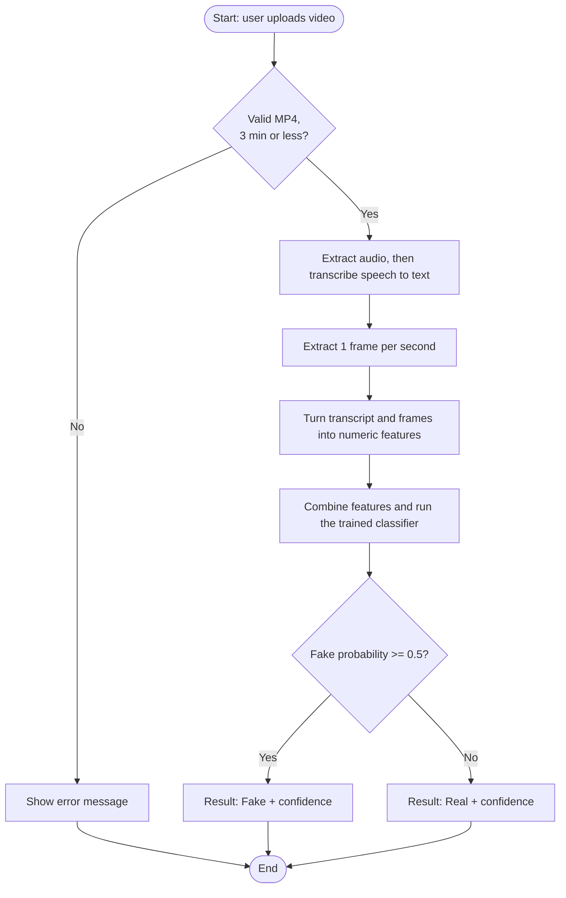

# Specialized Technology: Machine Learning

Machine learning (supervised, multimodal classification)

## 1. What it is
Machine learning (ML) creates an algorithm that can learn a rule from examples, rather than a rule that is hard coded by a programmer. Within supervised learning, each data point (TikTok videos in this case) have been labelled by a human which means we know if they are fake or real. The model can learn patterns from the examples to distinguish between fake and real, so it can be used on new examples (Pedregosa, et al., 2011).

## 2. Key concepts
Within this project a feature is a numeric representation of some property of a video for example how many alarm words are within the transcript. The label refers to the real answer to the training data, whether a video is a real or fake. The model takes the features and converts them into one output, this is the probability that the video is fake. During training the model will constantly have its parameters changed so that the model outputs can be matched to the true labels. We split our data up into 3 parts: Training data, Validation data and Test Data. Training data is used to teach the model. Validation data allows us to find optimal settings. Test data gives us an idea of the models final performance on unseen data. This helps to avoid overfitting, which can occur when the model has simply memorised the training data and performs poorly on new data. The model uses multimodal fusion to combine different signals, for example speech, visual and metadata into one output. We measure how well the model performed using precision, recall and F1 score. Precision measures how many of the videos we have flagged are actually fake. Recall measures how many of the fake videos we have flagged. The F1 score balances these two. These are much more informative than accuracy as we have very few fake videos.

## 3. How it would work for this project

1. Check the file is an actual mp4 file less than 3 minutes long.
2. Convert the speech to text using a speech recognition model (Radford et al., 2023).
3. Extract one frame per second from the video.
4. Create features. The text can be converted to numerical data (like word count, or vectors from a language model such as BERT (Devlin et al., 2019)). The frames can have image features extracted. Additional basic metadata can be added such as how long the video is.
5. Classify the video using the features. Output a probability the video is fake.
6. Display results with confidence score and transcript.

## 4. Worked example (illustrative numbers)
A simple classifier, logistic regression, multiplies each feature by a weight, adds a bias *b*, and turns the total *z* into a probability *p* = 1 / (1 + e^(-z)).

Made-up weights (not from a trained model): w1 = 0.5 for alarming words per 100 words, w2 = -1.5 for "named source mentioned" (1 = yes, 0 = no), b = -2.

| Video | x1: alarming words per 100 | x2: source named | z | p(fake) | Result |
|-------|---------------------------|------------------|---|---------|--------|
| A | 6 | 0 | -2 + 0.5(6) - 1.5(0) = 1.0 | 0.73 | Fake (73%) |
| B | 1 | 1 | -2 + 0.5(1) - 1.5(1) = -3.0 | 0.05 | Real (95%) |

In real training, the algorithm finds the weights automatically by minimising its errors on the labelled videos.

## 5. Frameworks, models, methods and tools
| Tool or method | Used for |
|----------------|----------|
| scikit-learn | Python library with baseline classifiers (logistic regression, support vector machine, random forest), the train/test split, and precision, recall and F1 (Pedregosa et al., 2011) |
| BERT | Pre-trained language model that turns a transcript into a vector that captures meaning, or can be fine-tuned to classify text (Devlin et al., 2019) |
| Whisper | Speech-recognition model trained on 680,000 hours of multilingual audio, used to create the transcript (Radford et al., 2023) |
| SV-FEND | Short-video fake news detector that uses links between modalities and social context such as comments and publisher profile; used as a reference design and baseline (Qi et al., 2023) |
| FakingRecipe | Method that looks at how a video is made (choice of material and editing patterns), not only what it says; a source of extra features (Bu et al., 2024) |

Datasets to check: FakeSV (Qi et al., 2023) and FakeTT (Bu et al., 2024). Check access and licence before use, and plan to collect a small labelled set of my own.

## 6. How it fits the problem
**Benefits**
- Scores a video in seconds, so fact-checkers can sort many videos and look first at the most likely fake ones.
- Can combine speech, images and metadata.
- Can be retrained when new data arrives.

**Limitations and risks**
- **Data needs:** needs many expert-labelled videos. Public datasets may differ in language and platform from the target videos.
- **Bias and wrong flags:** the model learns patterns such as topic or speaking style, which are not proof of falsehood. A real video can be flagged, which can harm the creator. The output is a warning for a human to check.
- **Changing topics:** fake news changes with events, so a model needs retraining.
- **Transcription errors and privacy:** noisy audio or mixed Malay and English can give a poor transcript. Uploaded videos must be deleted quickly (NFR3).

## 7. Alternative approach and choice
| Criterion | Machine learning classifier | Manual and rule-based checking |
|-----------|-----------------------------|--------------------------------|
| Speed and scale | Seconds per video, can sort thousands | Minutes to hours per video, limited by staff |
| New claims | Can score a new video, but may be wrong on new topics | Humans handle new claims well; rules and claim-matching only find claims already seen |
| Accuracy on a single claim | Lower than an expert, needs a human check | High when the expert has time and sources |
| Explanation | Weaker, needs transcript and confidence as support | Strong, reasoning and sources can be given |
| Cost | High set-up cost, low per video | Low set-up cost, high ongoing cost |

**Choice:** machine learning as a triage tool, with a human making the final decision. Manual checking cannot keep up with how fast videos spread, while a classifier can rank videos so human effort goes where it is most needed. Matching claims against existing fact-checks is a good later addition.

## References
- Bu, Y., Sheng, Q., Cao, J., Qi, P., Wang, D., & Li, J. (2024). *FakingRecipe: Detecting fake news on short video platforms from the perspective of creative process* (arXiv:2407.16670). arXiv. https://arxiv.org/abs/2407.16670
- Devlin, J., Chang, M.-W., Lee, K., & Toutanova, K. (2019). BERT: Pre-training of deep bidirectional transformers for language understanding. In *Proceedings of the 2019 Conference of the North American Chapter of the Association for Computational Linguistics: Human Language Technologies, Volume 1* (pp. 4171-4186). Association for Computational Linguistics. https://doi.org/10.18653/v1/N19-1423
- Pedregosa, F., Varoquaux, G., Gramfort, A., Michel, V., Thirion, B., Grisel, O., Blondel, M., Prettenhofer, P., Weiss, R., Dubourg, V., Vanderplas, J., Passos, A., Cournapeau, D., Brucher, M., Perrot, M., & Duchesnay, E. (2011). Scikit-learn: Machine learning in Python. *Journal of Machine Learning Research, 12*, 2825-2830. https://jmlr.org/papers/v12/pedregosa11a.html
- Qi, P., Bu, Y., Cao, J., Ji, W., Shui, R., Xiao, J., Wang, D., & Chua, T.-S. (2023). FakeSV: A multimodal benchmark with rich social context for fake news detection on short video platforms. *Proceedings of the AAAI Conference on Artificial Intelligence, 37*(12), 14444-14452. https://doi.org/10.1609/aaai.v37i12.26689
- Radford, A., Kim, J. W., Xu, T., Brockman, G., Mcleavey, C., & Sutskever, I. (2023). Robust speech recognition via large-scale weak supervision. In *Proceedings of the 40th International Conference on Machine Learning* (PMLR 202, pp. 28492-28518). https://proceedings.mlr.press/v202/radford23a.html